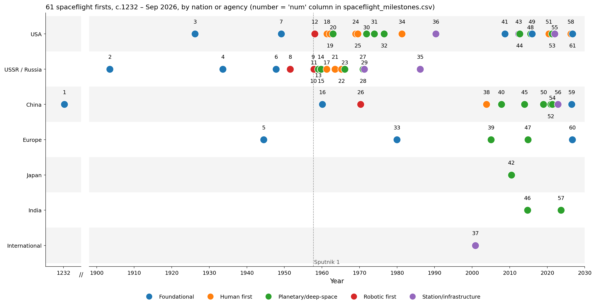
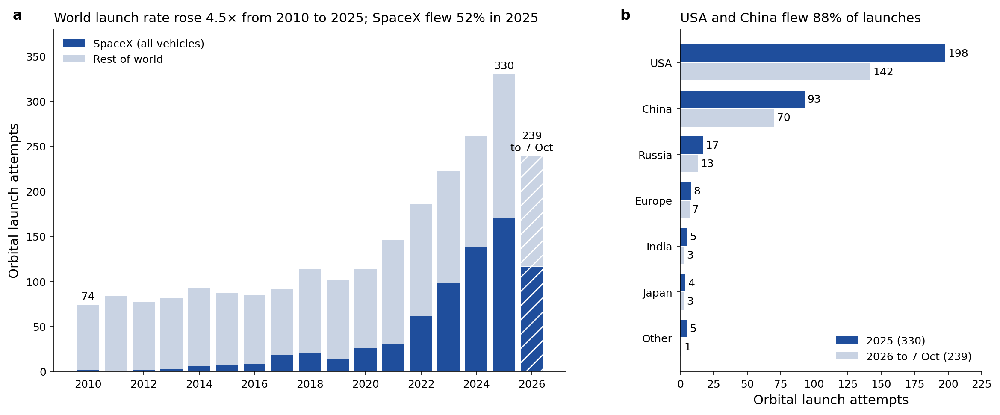
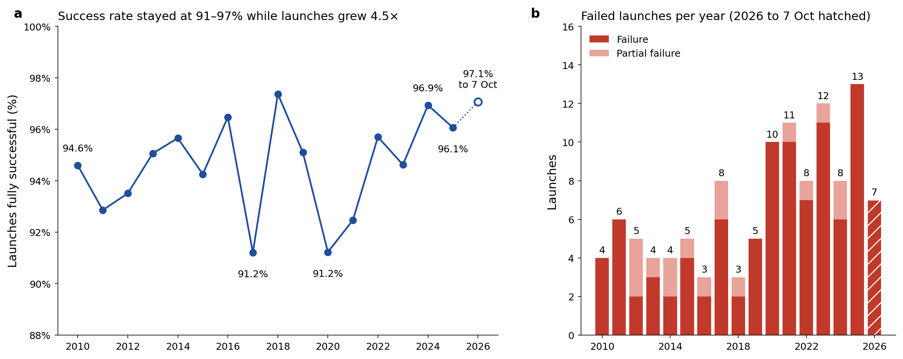
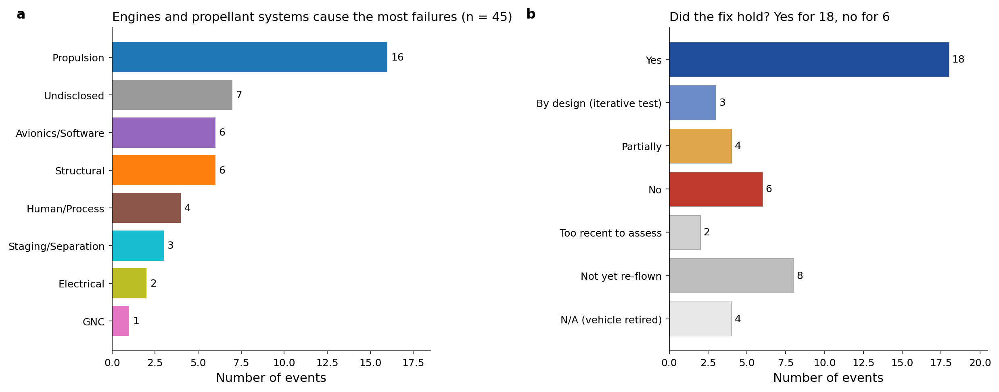
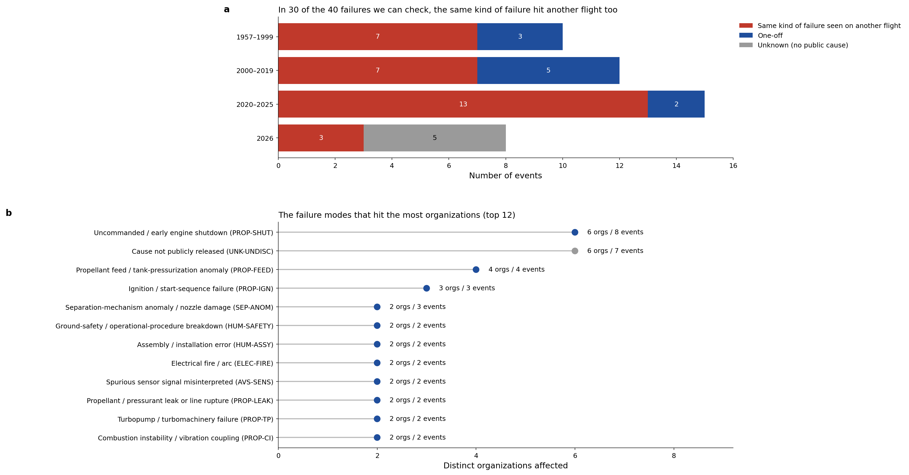
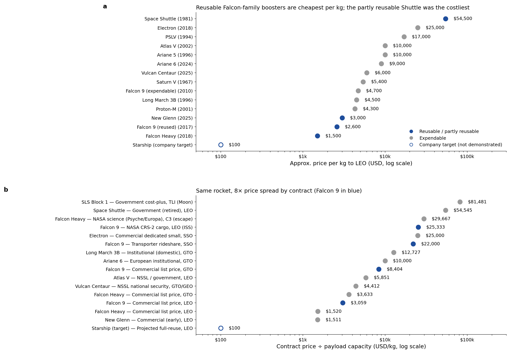
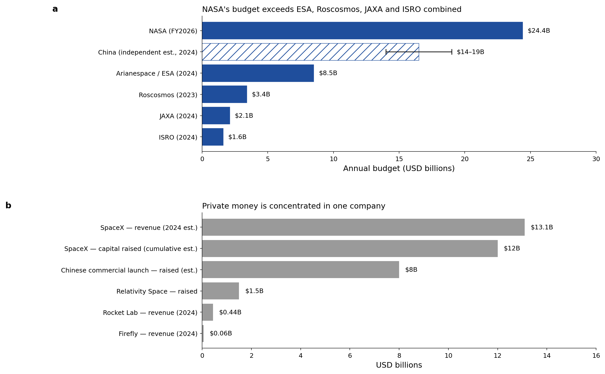
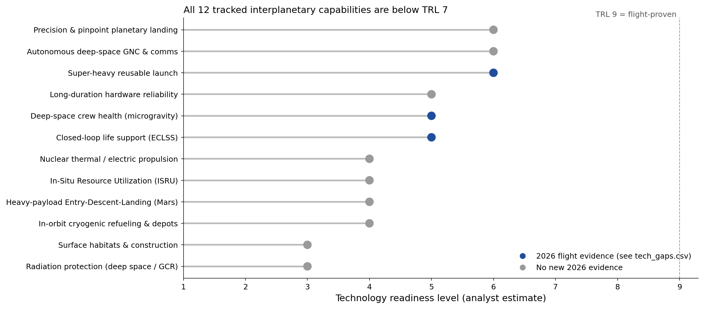

# Open Spaceflight Research

Open data on orbital launches, the failures among them, and whether the fixes worked. It covers
61 spaceflight firsts, 45 failures from 1957 to 2026 with their root causes, and a small SQLite
database (OSALR) for asking "has this failure happened before, and did the fix hold?" Data current to **9 October 2026**.

**At a glance:** 330 orbital launches in 2025, 96.1% fully successful · 239 in 2026 to 7 Oct ·
45 failures with root cause and fix outcome · 18 fixes that held · 24 organizations in OSALR.

**Contributions welcome.** Spotted a wrong date, a missing failure or a fix that didn't hold? Open an issue or a pull request.
You don't need to write code: most changes are one row in a CSV. See [Contributing](#contributing) for how.

## Key findings
- **Rockets fly far more often, and a slightly bigger share of them work.** World orbital launches rose from 74 in 2010 to 330 in 2025. The share that fully succeeded stayed between 91% and 97% every year, and reached 97.1% in 2026 so far.
- **Falcon 9 shows what a learned lesson looks like.** After losses in 2015 and 2016, both fixes held: it flew 275 times in 2025 and 2026 to date without a launch failure.
- **Most fixes hold, but the same kinds of failure keep coming back.** 18 fixes held on later flights and 6 did not. In 30 of 40 failures we can check, the same kind of failure also hit another flight. Uncommanded engine shutdown alone has hit 6 organizations since 1969.
- **The 2026 failures are hard to learn from.** 7 of the 8 failures logged this year have no public cause.
- **Launch is about 21× cheaper per kg than in the Shuttle era** (estimates): ~$54,500/kg for the Shuttle, ~$2,600 for a reused Falcon 9.
- **Crewed Mars flights are still far off.** All 12 capabilities we track sit at TRL 3–6 (our estimates). Deep-space radiation protection is the least mature.

## Repository layout
```
data/      the CSV datasets; edit these (failures.csv also feeds the database)
osalr/     OSALR database: osalr.db (built from data/failures.csv), failure-mode codes, schema, intake form, docs
images/    figures (generated by scripts/make_figures.py)
scripts/   make_figures.py, build_site.py, refresh_launch_logs.py
docs/      milestones.md, data-changelog.md (generated)
site/      the website (generated by scripts/build_site.py; don't edit by hand)
tests/     unit tests for the refresh script and site checks
```

| File | Rows | Contents |
|---|---:|---|
| [`data/failures.csv`](data/failures.csv) | 45 | 45 failures from 1957 to 2026: cause, lesson learned, source, failure-mode codes, and whether the fix held |
| [`data/launch_failures_2025_2026.csv`](data/launch_failures_2025_2026.csv) | 18 | Every orbital launch failure in 2025 and 2026 to date (Starship test flights excluded) |
| [`data/launch_cadence.csv`](data/launch_cadence.csv) | 17 | Orbital launches per year 2010–2026, with SpaceX share and successes, failures and partial failures (2026 partial) |
| [`data/launch_share.csv`](data/launch_share.csv) | 7 | Launches by country or bloc, 2025 and 2026 to date |
| [`data/organizations.csv`](data/organizations.csv) | 20 | Launch providers and agencies: vehicles, launches 2025/2026, reuse status |
| [`data/spaceflight_milestones.csv`](data/spaceflight_milestones.csv) | 61 | 61 spaceflight firsts, from c.1232 to 2026 |
| [`data/launch_costs.csv`](data/launch_costs.csv) | 15 | Approximate price per kg to LEO by vehicle (estimates) |
| [`data/cost_model.csv`](data/cost_model.csv) | 16 | Contract price ÷ payload capacity, by contract type (estimates) |
| [`data/funding.csv`](data/funding.csv) | 13 | Government space budgets (official) and private revenue and capital raised (estimates) |
| [`data/tech_gaps.csv`](data/tech_gaps.csv) | 12 | Readiness of 12 capabilities for crewed interplanetary flight (our TRL estimates), with 2026 evidence |
| [`data/changelog.csv`](data/changelog.csv) | 42 | Every edit in this revision, with its source |
| [`osalr/osalr.db`](osalr/osalr.db) | binary | SQLite failure database (rebuild with osalr/build_osalr.py) |
| [`osalr/failure_mode_taxonomy.csv`](osalr/failure_mode_taxonomy.csv) | 36 | Failure-mode codes: 8 classes and the modes under them |
| [`osalr/osalr_intake_template.csv`](osalr/osalr_intake_template.csv) | 24 | Fields and instructions for submitting a new failure |
| [`osalr/osalr_schema.sql`](osalr/osalr_schema.sql) | document | SQL schema for the SQLite database |
| [`osalr/failure_db_schema.json`](osalr/failure_db_schema.json) | document | Public failure-record schema |
| [`osalr/osalr_governance.md`](osalr/osalr_governance.md) | document | How a shared industry version could be run: access tiers, review, fix verification |
| [`osalr/query_demos.md`](osalr/query_demos.md) | document | Five example SQL queries and their output |
| [`docs/milestones.md`](docs/milestones.md) | document | All milestones, with category and why each matters |
| [`docs/data-changelog.md`](docs/data-changelog.md) | document | Data revision history with sources |
| [`LICENSE`](LICENSE) | document | MIT code licence |
| [`LICENSE-DATA.md`](LICENSE-DATA.md) | document | CC BY-SA 4.0 data, figure and text licence |

## Report
### About this data
Everything here is current to **9 October 2026**. Launch counts come from one source, Wikipedia's *"<year> in spaceflight"* summaries for 2010–2025 and the 2026 launch log through 7 October, and they include Starship flight tests. Other trackers count 2025 a little differently: SpaceNews has 324 launches, BryceTech 325, Jonathan McDowell 329 and Wikipedia 330.
A few kinds of numbers are estimates, and they are labelled as estimates wherever they appear: price per kg, technology readiness levels (TRL), China's space budget and private-company finances. Everything else is a dated event with a source. Every edit in this revision is listed in [docs/data-changelog.md](docs/data-changelog.md).

### 1 · Spaceflight firsts, 1232 to 2026
`spaceflight_milestones.csv` lists **61 firsts**: USA 23, USSR/Russia 18, China 11, and the rest from Europe, Japan, India and international projects.
- **Before Sputnik:** Jin-dynasty rocket weapons (c.1232; historians still argue about the exact devices, and the Wan Hu legend is left out), Tsiolkovsky's rocket equation (1903), Goddard's liquid-fuel rocket (1926), GIRD-09, the first Soviet liquid-fuel rocket (1933), the V-2 reaching space (1944), the first Soviet A-4 launches at Kapustin Yar (1947), Bumper 5, the first two-stage rocket to reach space (1949), and Dezik and Tsygan, the first dogs to fly to space and come back (1951).
- **2026 so far:** Artemis II (1–11 Apr) took four people around the Moon, the first crew beyond low Earth orbit since 1972 and the farthest anyone has been from Earth. China caught a Long March 10B booster at sea (10 Jul), becoming the second country to recover an orbital booster. Isar's Spectrum became the first rocket to reach orbit from Western Europe (5 Sep), and Starship Flight 14 (28 Sep) was Starship's first orbital and first commercial flight.


<sub>Spaceflight firsts by nation or agency. Numbers match the list in Appendix A.</sub>

### 2 · Launches: more of them, and more of them work
- World orbital launch attempts rose from **74 in 2010 to 330 in 2025**, 4.5× in 15 years. SpaceX flew **170 (52%)** of the 2025 launches.
- **2026 to 7 Oct: 239 launches**, 116 of them by SpaceX. The USA (142) and China (70) flew 89% of them, about the same share as in 2025 (88%).
- **Reliability held up under all that extra traffic.** 94.6% of launches fully succeeded in 2010, 96.1% in 2025 and 97.1% so far in 2026. Every year since 2010 landed between 91% and 97%; the worst were 2017 and 2020. Failures did go up in number, from 4 in 2010 to 13 in 2025, but far more slowly than launches.
- **Falcon 9 flew 275 times in 2025 and 2026 to date, and none of those launches failed.** Its two losses in our catalogue, CRS-7 (2015) and AMOS-6 (2016), both led to fixes that held.
- 2026 has had **7 launch failures** so far: China 4, India 1, Japan 1, USA 1. All 18 failures from 2025 and 2026 are listed in `launch_failures_2025_2026.csv`. That list follows Wikipedia's orbital launch tables, so it leaves out Starship test flights; Wikipedia's yearly failure count (13 for 2025) includes them.


<sub>(a) Orbital launch attempts per year; the hatched 2026 bar runs to 7 Oct. (b) Launches by country or bloc, 2025 and 2026 to date.</sub>


<sub>(a) Share of orbital launches that fully succeeded each year; the y-axis starts at 88%. (b) Failed and partly failed launches per year.</sub>

### 3 · What went wrong: 45 failures since 1957
`failures.csv` holds **45 failures**: 37 well-known events from 1957 to 2025, plus every orbital launch failure of 2026 and the New Glenn explosion on the pad. Five of them killed 96 people: the Nedelin disaster (1960, 78), Apollo 1 (1967, 3), Soyuz 1 (1967, 1), Challenger (1986, 7) and Columbia (2003, 7). No crew has been lost since Columbia. When Soyuz MS-10 failed on the way up in 2018, its escape system brought both astronauts home.
- **Engines and propellant systems cause the most failures** (16 of 45). The 7 events with no public cause are all from 2026.
- **Did the fix work?** For 18 failures, yes: the vehicle flew again without the same problem. For 6, no: the rocket failed again later (Vega, Astra, Firefly twice, Starship Flight 7→8 and PSLV-C61→C62), and in the Starship and PSLV cases it failed the same way. Another 8 are waiting for a return to flight, so it's too early to tell.
- **New Glenn (28 May 2026)** exploded during a static fire and badly damaged Launch Complex 36. Blue Origin traced it (5 Aug) to a BE-4 main oxygen valve. That makes three rockets lost on the ground in ten years, after AMOS-6 (2016) and Starship Ship 36 (2025).


<sub>(a) Main root cause of each failure. (b) Whether the fix held on later flights.</sub>

### 4 · What we learned
Most failures teach something specific, and 18 of those lessons have held up on later flights. Six of them:
- **Apollo 1 (1967):** no more pure-oxygen cabins on the pad, and a hatch that opens outward in seconds. No Apollo cabin fire happened again.
- **Mars Climate Orbiter (1999):** one system of units across every contractor, enforced through interface documents. No mission in our catalogue has been lost to a units mix-up since.
- **Columbia (2003):** treat "in-family" anomalies like foam strikes as real risks, and inspect the heat shield in orbit. The Shuttle flew 22 more missions without a loss before it retired in 2011.
- **Falcon 1 Flight 3 (2008):** allow for leftover engine thrust when timing stage separation. Flight 4 reached orbit, the first privately built liquid-fuel rocket to do so.
- **Soyuz MS-10 (2018):** a sensor bent during assembly caused the failure, and the abort system did its job. Assembly checks changed and the problem hasn't come back.
- **H3 (2023 and 2025):** JAXA fixed a second-stage ignition fault after the first flight and an upper-stage problem in 2025. H3 has since flown successfully, twice in 2026 alone.

The harder lesson is that the same kinds of failure keep turning up at different companies. In **30 of the 40 failures we can check (75%)**, the same kind of failure also hit another flight, before or after. Uncommanded engine shutdown alone has hit 6 organizations in 3 countries since 1969, from the Soviet N1 to Japan's H3.
- **2026 has a disclosure problem.** 7 of the 8 failures logged this year have no public cause, so nobody outside the operator can learn from them. PSLV-C62 failed in the same third-stage phase as PSLV-C61 eight months earlier, and ISRO has not published the C62 inquiry report it completed on 13 Jun 2026.
- **OSALR (Open Spaceflight Anomaly & Lesson Repository)** is a small SQLite database built to answer two questions fast: has this failure mode happened before, and did the fix hold? It holds the same 45 events from 24 organizations, tagged with 36 failure-mode codes in 8 classes (`UNK` covers undisclosed or undetermined causes), plus a source and a fix outcome for each. `build_osalr.py` rebuilds it from `failures.csv` on every build, so the CSV is the only thing you ever edit. `query_demos.md` has five example queries, and `osalr_governance.md` sketches how a shared industry version could work.


<sub>(a) Failures whose kind also hit another flight, by era. (b) Failure modes ranked by how many organizations they have hit.</sub>

### 5 · Cost per kilogram
- Rough price per kg to low Earth orbit (*estimates*): Space Shuttle ~$54,500, reused Falcon 9 ~$2,600, Falcon Heavy ~$1,500. That's about 21× cheaper than the Shuttle, which was partly reusable too but expensive to refurbish between flights. Starship's ~$100/kg is a company target and hasn't been demonstrated.
- **What you buy matters as much as the rocket.** A Falcon 9 commercial launch to LEO lists at $3,059/kg. NASA's ISS cargo contract (CRS-2) works out to $25,333/kg, 8× more, but that price also covers the Dragon capsule and cargo services. SLS to the Moon costs about $81,481/kg per launch, not counting development.


<sub>(a) Approximate price per kg to LEO by vehicle (estimates). (b) Contract price divided by payload capacity, by contract type.</sub>

### 6 · Who pays for spaceflight
- **NASA's FY2026 budget is $24.4B.** In January 2026 Congress turned down nearly all of a proposed 24% cut; the FY2027 request proposes a 23% cut again. NASA alone outspends ESA (~$8.5B, 2024), Roscosmos (~$3.4B, 2023), JAXA (~$2.1B) and ISRO (~$1.6B) combined. China publishes no figure; independent estimates put it at $14–19B.
- **Private money is concentrated in one company.** SpaceX took in about $13B of revenue in 2024 (est.). For scale, all of China's commercial launch startups together have raised about $8B in investment (est.).


<sub>(a) Government space budgets; China is an independent estimate range. (b) Private revenue and capital raised (estimates).</sub>

### 7 · What's still missing for crewed Mars flights
We track 12 capabilities a crewed interplanetary mission needs, and all of them sit at TRL 3–6 (*our estimates, not agency ratings*; TRL 9 means flight-proven). 2026 brought real flight evidence in two areas: super-heavy reuse (Starship reached orbit, and China recovered Long March 10B and Zhuque-3 boosters) and deep-space crew operations (Artemis II). The least mature haven't moved: deep-space radiation protection and surface habitats (TRL 3), then ISRU, Mars entry-descent-landing, nuclear propulsion and cryogenic refuelling (TRL 4). As of October 2026 nobody has reported a ship-to-ship transfer of cryogenic propellant.


<sub>Readiness of each capability (our estimates). Blue means new flight evidence in 2026.</sub>

### 8 · Open work: where you can help
1. **Add the 8 remaining 2025 failures to OSALR:** Spectrum F1, Eris F1, Zhuque-2E Y3, Ceres-1 Y19, Kuaizhou-1A Y33, Hanbit-Nano, Simorgh and Zuljanah. They are already in `launch_failures_2025_2026.csv` and need a cause, lesson and failure-mode code.
2. **Update the 8 "not yet re-flown" records** when each vehicle flies again. Next up: PSLV-C63 (Nov 2026) and Astrobotic Griffin-1 (no earlier than Nov 2026). New Glenn has no date yet.
3. **Find cause statements** from ISRO, CASC, Space One, Space Pioneer, Galactic Energy and Blue Origin. Every `UNK-UNDISC` record that gets a cause becomes a lesson others can use.
4. **Replace estimates with primary sources:** agency-published TRLs, contract award prices (NASA and NSSL notices) for `cost_model.csv`, and official FY2026 budgets for ESA, JAXA and ISRO.
5. **Log what happens next:** Starship Flight 15, Mengzhou-1 on Long March 10A, Gaganyaan G1 (HLVM3), JAXA's MMX (20 Oct) and Starliner-1 (Dec) are all due in Q4 2026.


Full milestone list: [docs/milestones.md](docs/milestones.md) · Edits in this revision: [docs/data-changelog.md](docs/data-changelog.md)

## Reproduce
```bash
pip install -r requirements.txt
python scripts/build.py           # rebuild and validate the complete site
python -m unittest discover -s tests   # builds osalr/osalr.db first if it's missing

# Or run individual steps:
python osalr/build_osalr.py        # rebuild osalr/osalr.db from data/failures.csv
python scripts/make_figures.py     # regenerate images/
python scripts/build_site.py       # regenerate README.md, docs/ and site/
python scripts/refresh_launch_logs.py   # optional: re-fetch Wikipedia launch logs and write a comparison to build/refresh/
```
`refresh_launch_logs.py` never overwrites `data/`. It writes fresh counts to `build/refresh/` so that changes can be reviewed before they are copied in.

To check your change in the browser, run `python -m http.server -d site 8000` and open http://localhost:8000.

## Contributing
Corrections and new records are welcome, from one fixed date to a whole new dataset. Section 8 of the report lists open work if you're looking for a place to start. Not sure a change is right? Open an issue first and we'll work it out together.
- **Add or correct a failure:** `osalr/osalr_intake_template.csv` explains every field. Add or edit the row in `data/failures.csv`, run `python scripts/build.py` to rebuild the database and site, and open a pull request. Every cause statement needs a primary source.
- **Fix other data:** edit the CSV, add a row to `data/changelog.csv` saying what changed and where it came from, then run `python scripts/build.py` and `python -m unittest discover -s tests`.
- **Commit the generated files too.** CI rebuilds everything and fails if `README.md`, `docs/` or `site/` differ from what's committed.
- Record IDs, access tiers and how fix outcomes are judged are described in [osalr/osalr_governance.md](osalr/osalr_governance.md).
- Everyone taking part agrees to the [Code of Conduct](CODE_OF_CONDUCT.md).

## Sources and licence
- Launch counts, yearly success and failure counts, and 2025–2026 failure entries: Wikipedia, *"<year> in spaceflight"* and *"List of spaceflight launches in …"* (retrieved 9 October 2026). Historical failures cite their accident-board reports in `primary_reference`.
- Estimates (cost per kg, contract $/kg, TRL, China's budget, private funding) are labelled as estimates in the data and text.
- **Code** (`scripts/`, `osalr/build_osalr.py`): MIT licence, see [LICENSE](LICENSE).
- **Data, figures and text**: [CC BY-SA 4.0](LICENSE-DATA.md). Share-alike is required because parts are derived from Wikipedia (CC BY-SA 4.0).
